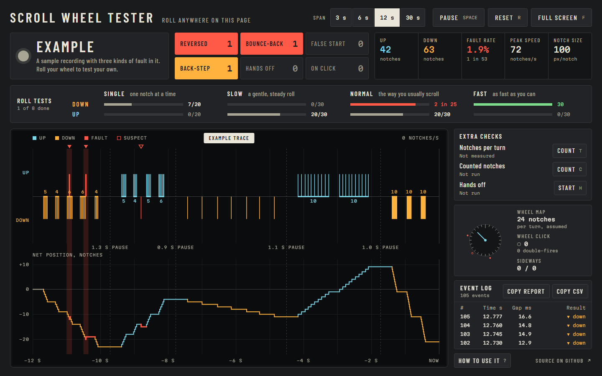

# Scroll Wheel Tester

Think your mouse's scroll wheel is going bad? This page tests it and tells you.

## [Open the tester →](https://sirsnipesalot.github.io/scroll-wheel-tester/)

It runs in your browser. There is nothing to download or install.

## What it is for

Scroll wheels wear out. The usual signs:

- you scroll down and the page twitches back up
- the page creeps back a step when you stop scrolling
- in a game, you scroll to the next weapon and get the previous one
- the wheel scrolls when you are not touching it

Some mice have a reputation for it. The Razer DeathAdder V3 Pro is one: [this owner](https://insider.razer.com/razer-support-45/deathadder-v3-pro-scroll-wheel-registers-the-wrong-direction-wired-and-wireless-92921) logged its wheel sending 6 of 37 notches the wrong way.

The tester records every signal your wheel sends while you roll it and counts the ones that should not be there. Use it to find out whether the wheel really is faulty **before** you file a warranty claim or order a replacement encoder (the part behind the wheel) to solder in. When you are done, it gives you a text report you can paste into the claim.

You need a desktop or laptop computer and the mouse you want to test. It is for mouse wheels, not touchpads, and it does not work on phones.

## How to test your wheel

One word you will see a lot: a **notch** is one click of the wheel, the smallest step you can feel.

### 1. Open the page and roll the wheel

When the page opens it shows an example recording, marked **EXAMPLE**, so you can see what a result looks like. That is not your mouse. It clears the moment you roll your wheel.

Put the pointer anywhere on the page and roll. The page itself will not scroll, because the tester takes over the wheel while it is recording. Press `Space` to pause and get normal scrolling back.

### 2. Do the eight roll tests

The grid labelled **ROLL TESTS**, just above the chart, is the actual test. It has eight boxes: four ways of rolling the wheel across the top, each done downwards (the **DOWN** row) and upwards (the **UP** row).

| Box | What to do | How much |
| --- | --- | --- |
| **Single** | One notch at a time. Click, pause, click, pause. | 20 notches |
| **Slow** | Roll gently and steadily, slower than you normally scroll, without stopping between notches. | 30 notches |
| **Normal** | Scroll the way you usually do. | 30 notches |
| **Fast** | Flick the wheel as fast as you comfortably can. | 30 notches |

You do not select a box. Just roll. The tester works out how fast you rolled and fills the matching box. If the wrong box is filling, roll a little faster or slower.

Each box shows a count such as `12/30` and a bar that turns green when the box is done. Next to the label you can see how many of the eight are finished.

**Do all eight.** A worn wheel often misbehaves at one speed or in one direction only, so a wheel that looks fine during normal scrolling can still fail the slow test. The tester will not call a wheel clean until all eight boxes are green.

### 3. Read the verdict

The big lamp at the top left is the verdict.

| It says | What it means |
| --- | --- |
| **Example** | You are looking at the sample recording. Roll your wheel to start. |
| **Ready** | Nothing recorded yet. |
| **Clean so far** | No faults yet, but the roll tests are not finished. It lists the ones still to do. |
| **Clean** | All eight roll tests are done and nothing went wrong. |
| **Suspect** | The wheel has sent one or two faults. Keep rolling to see if it happens again. |
| **Faulty wheel** | The wheel has sent three or more faults. |
| **Check your technique** | The only problems seen were the kind your finger can cause. See Back-step in the next step. |
| **High-resolution wheel** | Your mouse is in a smooth scrolling mode that the tester cannot judge. See [Troubleshooting](#troubleshooting). |

Faults are reported the moment they happen, so a bad wheel can show **Faulty wheel** within seconds. **Clean** is different: it only appears after all eight roll tests are done.

### 4. See what went wrong

Next to the verdict are six lamps, one for each kind of fault. A lamp lights up and counts every time its fault happens.

| Lamp | What the wheel did | What you see in normal use |
| --- | --- | --- |
| **Reversed** | Sent a notch in the wrong direction while you were rolling | The page twitches the wrong way mid-scroll |
| **Bounce-back** | Sent a wrong-way notch just as you stopped | The page creeps back a step when you stop |
| **False start** | Sent a wrong-way notch just as you started | The page jumps the wrong way first |
| **Hands off** | Sent notches while nobody was touching it | The page moves by itself |
| **Back-step** | Sent one slow wrong-way notch in a pause between rolls | The same as bounce-back |
| **On click** | Sent notches while you pressed the wheel button | The page scrolls when you middle-click |

The first four light up **red**. These are the wheel's fault, not yours. Three of them happen faster than a finger can turn a wheel back, and the fourth happens with no finger on the wheel at all. They are what the verdict counts.

The last two light up **amber**. They are suspects, because you can cause them yourself. A back-step can be your finger dragging the wheel backwards on its way to the next roll, and pressing the wheel button can nudge the wheel. If Back-step is the only lamp lit, lift your finger clear of the wheel between rolls and test again. If the back-steps stop, it was your finger.

### 5. Run the extra checks (optional)

The **EXTRA CHECKS** panel on the right has three more tests. They are optional, but each one catches a fault that rolling alone cannot.

- **Counted notches** (press `C`). Roll exactly ten notches in one direction, slowly, counting the clicks you feel. Then press `Enter`. If the tester counted nine, the wheel is dropping notches. If it counted eleven, it is doubling them. Try it a few times in each direction.
- **Hands off** (press `H`). Take your finger off the wheel for ten seconds. Slide the mouse about, lift it and put it down, click the other buttons. If the wheel reports anything, it is moving by itself.
- **Notches per turn** (press `T`). Put a mark on the wheel, line it up with the mouse body, roll one full turn until the mark is back, and press `Enter`. This tells you how many notches your wheel has. Most have 24. It also makes the wheel map on the right accurate.

### 6. Copy the report

Press **Copy report**, above the event log. It copies a plain-text summary of the whole test: the verdict, how much you rolled, every kind of fault and how often it happened. Paste it into a warranty claim, a support ticket or a forum post.

**Copy CSV** copies every signal the wheel sent, as a list you can open in a spreadsheet.

## If it says your wheel is faulty

Rule out everything that is not the wheel before you pay for anything.

1. Close the mouse maker's software (Razer Synapse, Logitech G HUB and so on), or turn off any smooth scrolling option in it. Test again.
2. Plug the mouse, or its wireless receiver, straight into the computer instead of a hub. Try a different USB port.
3. Blow the wheel out with compressed air. Dust and hair around the wheel cause exactly these faults.
4. Test the mouse on another computer.

If the fault is still there after all that, it is the mouse. Under warranty, send the copied report with your claim. Out of warranty, the usual repair is replacing the wheel encoder.

## The rest of the screen

- **Numbers at the top right.** *Up* and *Down* are the notches counted in each direction. *Fault rate* is how often the wheel sent a certain fault, for example "1 in 26". *Peak speed* is your fastest roll, in notches per second. *Notch size* is how far your browser scrolls for one notch, normally a fixed number such as 100.
- **The chart.** The top half draws every signal from the wheel as a bar: above the line for up, below the line for down, red for a fault. The number beside each run of bars is how many notches it had. The bottom half shows where the wheel has got to. The chart only moves while the wheel is moving.
- **Wheel map.** A dial showing one full turn of the wheel, with a dot wherever a fault happened. If the dots pile up in one place, the fault may sit at one spot on the wheel.
- **Wheel click** counts presses of the wheel button. A "double-fire" is a second press that arrives too soon after the first to be you, which points to a worn button.
- **Sideways** counts left and right signals, if your wheel tilts.
- **Event log.** Every signal, newest first.
- **Span** sets how many seconds of rolling fit across the chart. **Pause** stops recording and gives the wheel back to the page. **Reset** clears the recording. **Full screen** does what it says.
- **How to use it**, at the bottom right, opens a short version of this guide on the page. The **Source on GitHub** link next to it brings you back here.

## Keyboard shortcuts

| Key | What it does |
| --- | --- |
| `Space` | Pause or resume. While a counting check is running, it finishes the check instead. |
| `R` | Reset |
| `F` | Full screen |
| `C` | Start the Counted notches check |
| `H` | Start the Hands off check |
| `T` | Start the Notches per turn check |
| `Enter` | Finish the check that is running |
| `Esc` | Cancel the check that is running |
| `?` | Open the on-page guide |

## Troubleshooting

**Nothing happens when I roll the wheel.** The pointer has to be over the page. If the Pause button reads "Resume", the tester is paused: press `Space`.

**The verdict says "High-resolution wheel".** Your mouse is sending several signals for every notch. Some mice do this in a smooth scrolling mode, and in that mode the wheel steps back slightly every time it settles, which looks like a fault but is not. Turn smooth or high-resolution scrolling off in the mouse's software and test again.

**Notch size says "varies".** The signals are not all the same size. That happens with touchpads, with free-spinning wheels, and on computers that speed scrolling up the faster you go, such as Macs. The tester still works, but the lamps are less reliable.

**Only the Back-step lamp is lit.** That is usually your finger, not the wheel. See step 4.

**Can I use it on a touchpad or a phone?** No. It is built for a mouse wheel.

## Install it (optional)

In Chrome or Edge, use the install button in the address bar. The tester then opens in its own window and works without an internet connection.

## Good to know

- **How it tells a fault from your finger.** A healthy wheel only ever sends notches in the direction you are rolling. The tester treats a notch as a certain fault when it flips direction within 60 milliseconds, which is faster than a finger can turn a wheel back.
- **It only sees what your browser sees.** In a fast flick the browser can merge a stray notch into the real ones, so some faults hide at high speed. That is why the Single and Slow roll tests matter most.
- **A clean result is not a guarantee.** A fault that shows up once an hour can miss a two-minute test. If the mouse still misbehaves, test again for longer.
- **It has been run on a real faulty wheel.** It was tested on a Razer DeathAdder V3 Pro with a failing scroll wheel. (That wheel got rolled so much during testing that it started behaving again.) It has not been tried on many other mice yet, so if it gets yours wrong, please open an issue and paste the copied report.

## For developers

Everything is in `index.html`. There is no build step and there are no dependencies apart from two Google Fonts. The timing rules sit in the `CFG` block at the top of the script. `sw.js` and `manifest.webmanifest` make the page installable and usable offline.

## Licence

GNU General Public License v3.0. See [LICENSE](LICENSE).
